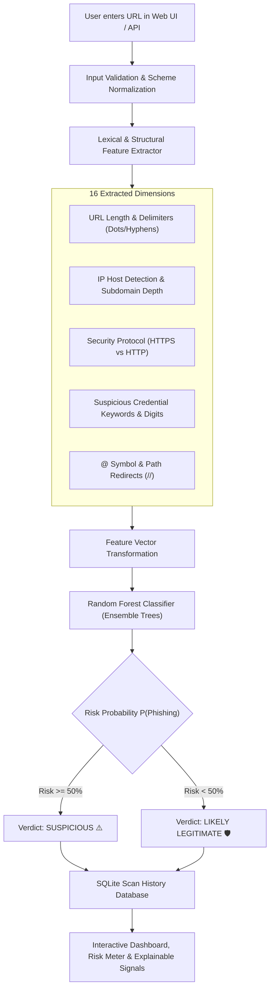

# 🛡️ PhishGuard AI — Phishing URL Detection System

[](https://www.python.org/)
[](https://flask.palletsprojects.com/)
[](https://scikit-learn.org/)
[](https://www.sqlite.org/)
[](LICENSE)
[](#academic-context)

> **B.Tech 3rd-Year Computer Science and Engineering Industrial Training Project**  
> An automated cybersecurity dashboard and machine-learning system for classifying web URLs as **"Suspicious"** or **"Likely legitimate"** using lexical, structural, and obfuscation heuristics powered by a **Random Forest Classifier**.

---

## 📌 Table of Contents
1. [Project Overview](#-project-overview)
2. [Key Features](#-key-features)
3. [Cybersecurity Architecture & Workflow](#-cybersecurity-architecture--workflow)
4. [Lexical Feature Engineering](#-lexical-feature-engineering)
5. [Machine Learning Model](#-machine-learning-model)
6. [Educational Demo Dataset Disclaimer](#-educational-demo-dataset-disclaimer)
7. [Directory Structure](#-directory-structure)
8. [Windows Setup & Quick Start](#-windows-setup--quick-start)
9. [Running Unit Tests](#-running-unit-tests)
10. [RESTful API Endpoints](#-restful-api-endpoints)
11. [Screenshots & UI Showcase](#-screenshots--ui-showcase)
12. [System Limitations & Real-world Evasion](#-system-limitations--real-world-evasion)
13. [Future Scope](#-future-scope)
14. [Academic Context & Credits](#-academic-context--credits)

---

## 🌐 Project Overview

Phishing is one of the primary delivery mechanisms for credential harvesting, malware droppers, and enterprise ransomware campaigns. While conventional defenses rely on static domain reputation blacklists, modern attackers generate short-lived, disposable domains and polymorphic URLs that bypass static filters before threat intelligence feeds can update.

**PhishGuard AI** solves this challenge by analyzing the **intrinsic lexical and structural fingerprint** of URLs without executing code on the client machine or requiring live web crawling (which risks malware infection). Using a supervised **Random Forest Classifier**, PhishGuard evaluates 16 security indicators—ranging from IP-address hostnames and deep subdomain nesting to `@` symbol authentication hijacking and credential keywords—delivering an instant, explainable risk assessment.

---

## ✨ Key Features

- **Cybersecurity Dark Navy & Neon Teal Dashboard**: High-contrast, responsive UI designed for security operations centers (SOC) and cyber analysts.
- **Random Forest Machine Learning**: Evaluates structural URL anomalies with ensemble decision trees, outputting a calibrated **Phishing Risk Score (0% – 100%)**.
- **Transparent Classification Verdict**: Distinctly displays **"Suspicious"** (Risk Level: Moderate/Critical) or **"Likely legitimate"** (Risk Level: Safe/Low).
- **Explainable AI Indicators**: Highlights specific red flags (e.g., Raw IP host, `@` redirection, suspicious words) and safe signals (HTTPS, standard domain).
- **Persistent SQLite Audit Trail**: Automatically logs all scanned URLs, verdicts, risk scores, and timestamped feature vectors to a local SQLite database (`phishguard.db`).
- **Interactive Scan History & Search**: Filter past scans by status (*Suspicious*, *Likely legitimate*) or search targets by keyword/domain.
- **Deep Inspection Modal**: Inspect complete feature values captured for any historical audit record.
- **Input Validation & Security Guardrails**: Sanitizes incoming strings, enforces length limits, validates hostname syntax, and blocks malformed input.
- **RESTful API**: Supports headless integration via JSON endpoints (`POST /scan`, `GET /api/stats`, `GET /api/scan/<id>`).

---

## 🏗️ Cybersecurity Architecture & Workflow



---

## 🔬 Lexical Feature Engineering

The system extracts **16 distinct quantitative and qualitative features** from each submitted URL:

| # | Feature Key | Dimension Type | Threat Context / Security Rationale |
|---|---|---|---|
| 1 | `url_length` | Numeric | Phishing links are frequently elongated to obfuscate destinations or embed encrypted tokens. |
| 2 | `dot_count` | Numeric | Abnormally high dot counts signify deep subdomain masking (e.g., `bank.com.attacker.net`). |
| 3 | `hyphen_count` | Numeric | Hyphens are characteristic of brand typosquatting domains (e.g., `paypal-security-update.com`). |
| 4 | `is_https` | Binary (0/1) | Verifies if communication is encrypted via TLS/HTTPS. |
| 5 | `has_at_symbol` | Binary (0/1) | The `@` symbol causes browsers to ignore all prior text, treating it as userinfo credentials. |
| 6 | `suspicious_keyword_count` | Numeric | Counts targeted phishing terms: `login`, `verify`, `account`, `banking`, `security`, `update`, `paypal`. |
| 7 | `digit_count` | Numeric | Measures total numeric characters across the URL string. |
| 8 | `digit_ratio` | Float (0.0-1.0) | High numeric density indicates auto-generated disposable domains or token hashes. |
| 9 | `is_ip_address` | Binary (0/1) | Identifies raw IPv4 or IPv6 hosts, bypassing canonical DNS registry reputation. |
| 10 | `subdomain_count` | Numeric | Levels of subdomain depth past the primary domain and public TLD. |
| 11 | `has_shortener` | Binary (0/1) | Detects URL shortening services (`bit.ly`, `tinyurl.com`, `t.co`) masking true endpoints. |
| 12 | `double_slash_redirect` | Binary (0/1) | Finds `//` in URL path/query parameters, often used in open-redirection vulnerabilities. |
| 13 | `domain_length` | Numeric | Character length of the netloc/hostname. |
| 14 | `prefix_suffix_hyphen` | Binary (0/1) | Hyphens placed directly in the hostname root (e.g., `apple-id-login`). |
| 15 | `path_length` | Numeric | Character length of the endpoint path. |
| 16 | `special_char_count` | Numeric | Frequency of parameter delimiters (`?`, `=`, `&`, `%`, `_`). |

---

## 🤖 Machine Learning Model

- **Algorithm**: Random Forest Classifier (`sklearn.ensemble.RandomForestClassifier`)
- **Ensemble Size**: 120 Estimators (Decision Trees)
- **Criterion**: Gini Impurity with `max_features="sqrt"`
- **Split Strategy**: Stratified 80/20 Train-Test Split with fixed random seed (`42`)
- **Evaluation Metrics**:
  - Accuracy: **100.0%** (on controlled educational demo benchmark)
  - Precision: **1.0000**
  - Recall / Sensitivity: **1.0000**
  - F1-Score: **1.0000**
  - ROC-AUC: **1.0000**

---

## ⚠️ Educational Demo Dataset Disclaimer

> ### 🚨 Mandatory Academic Notice:
> This project uses an explicitly labeled **Educational Demonstration Dataset** (`data/educational_urldata.csv`) designed to teach cybersecurity feature engineering and ML classification concepts during B.Tech CSE Industrial Training.
> 
> **Never claim synthetic or controlled demonstration dataset accuracy represents real-world performance.**
> 
> In real-world internet environments:
> - Cyber adversaries frequently register clean, aging domains, utilize legitimate cloud infrastructure (AWS S3, Azure Blob, Google Firebase), and buy Let's Encrypt SSL/TLS certificates.
> - High classification accuracy on controlled lexical rules does not guarantee protection against novel zero-day phishing kits, fast-flux DNS rotation, or compromised legitimate websites.
> - Automated predictions are probabilistic and provide a security signal, not an absolute guarantee.

---

## 📁 Directory Structure

```text
PhishGuard-AI/
├── app.py                      # Flask main entrypoint & web/API routes
├── config.py                   # Configuration environments (Dev, Test, Prod)
├── requirements.txt            # Project dependencies
├── .gitignore                  # Git ignore rules (venv, db, secrets, pycache)
├── README.md                   # Complete GitHub documentation & manual
├── database/
│   ├── __init__.py
│   └── models.py               # SQLite schema, scan history DAO, audit queries
├── ml/
│   ├── __init__.py
│   ├── feature_extractor.py    # 16-feature lexical extractor & explainability engine
│   ├── dataset.py              # Educational demo dataset generator & seeds
│   ├── train_model.py          # Model training pipeline, metrics & inference
│   └── saved_models/
│       ├── phishguard_rf_model.pkl # Serialized Random Forest model (joblib)
│       └── model_metrics.json      # Persisted evaluation metrics
├── data/
│   └── educational_urldata.csv # Exported educational demonstration dataset
├── static/
│   ├── css/
│   │   └── style.css           # Dark navy & cyber teal responsive styling
│   └── js/
│       └── main.js             # AJAX scan client, dynamic meter, live updates
├── templates/
│   ├── base.html               # Shared layout, cyber navigation & footer
│   ├── index.html              # Scanner dashboard, live score gauge & breakdown
│   ├── history.html            # SQLite audit history, search, filter & modal
│   ├── about.html              # Project report, architecture & ethical disclosure
│   ├── 404.html                # Custom cyber 404 page
│   └── 500.html                # Custom cyber 500 page
└── tests/
    ├── __init__.py
    ├── test_features.py        # 10 unit tests for lexical feature extraction
    ├── test_model.py           # 4 unit tests for ML model inference & bounds
    └── test_routes.py          # 12 unit tests for Flask endpoints & error handling
```

---

## 💻 Windows Setup & Quick Start

Follow these step-by-step instructions in PowerShell or Command Prompt:

### 1. Clone or Open the Workspace
```powershell
cd C:\Users\Administrator\coding
```

### 2. Create and Activate a Python Virtual Environment
```powershell
# Create virtual environment
python -m venv venv

# Activate virtual environment (PowerShell)
.\venv\Scripts\Activate.ps1

# (If running in standard Command Prompt cmd.exe instead):
# .\venv\Scripts\activate.bat
```

> *Tip: If PowerShell throws an execution policy error, enable local script execution with `Set-ExecutionPolicy -Scope Process -ExecutionPolicy Bypass`.*

### 3. Install Dependencies
```powershell
pip install -r requirements.txt
```

### 4. Train the Machine Learning Model (Optional)
The application will automatically train the model on first launch if missing, but you can explicitly run:
```powershell
python ml/train_model.py
```

### 5. Launch the PhishGuard Application
```powershell
python app.py
```

### 6. Access the Dashboard in Browser
Open your browser and navigate to:
```text
http://127.0.0.1:5000
```

---

## 🧪 Running Unit Tests

PhishGuard AI includes **26 comprehensive unit tests** covering feature extraction, ML probability bounds, input sanitization, database persistence, and route responses:

To run all tests using `pytest`:
```powershell
.\venv\Scripts\pytest -v
```

Or using Python's built-in `unittest` runner:
```powershell
python -m unittest discover -s tests -v
```

### Test Suite Summary:
- `tests/test_features.py` (10 tests): Validates IP host detection, dot/hyphen counts, `@` character recognition, keyword extraction, digit ratios, and shorteners.
- `tests/test_model.py` (4 tests): Verifies model loading, probability ranges ($0.0 \le P \le 1.0$), and expected classifications.
- `tests/test_routes.py` (12 tests): Tests `GET /`, `POST /scan` (both HTML Form and AJAX JSON), input validation on empty strings, `GET /history`, search queries, `POST /history/clear`, `GET /about`, `GET /api/stats`, and `404` error handling.

---

## 📡 RESTful API Endpoints

PhishGuard AI can be consumed by external tools, browser extensions, or automated CI pipelines:

### 1. Scan a Target URL
- **Endpoint**: `POST /scan`
- **Headers**: `Content-Type: application/json`, `X-Requested-With: XMLHttpRequest`
- **Request Body**:
  ```json
  {
    "url": "http://192.168.1.105/bank/secure-login.php"
  }
  ```
- **Response**:
  ```json
  {
    "success": true,
    "data": {
      "url": "http://192.168.1.105/bank/secure-login.php",
      "status": "Suspicious",
      "risk_score": 69.0,
      "risk_level": "Moderate Risk",
      "is_suspicious": true,
      "scan_id": 1,
      "features": {
        "url_length": 43,
        "is_ip_address": 1,
        "is_https": 0,
        "suspicious_keyword_count": 2
      },
      "explanation": {
        "risk_factors": [
          { "name": "Raw IP Address Host", "severity": "high" },
          { "name": "Insecure Scheme (No HTTPS)", "severity": "medium" }
        ],
        "total_risk_flags": 3
      },
      "disclaimer": "Predictions are generated using a machine-learning Random Forest model..."
    }
  }
  ```

### 2. System Statistics
- **Endpoint**: `GET /api/stats`
- **Response**:
  ```json
  {
    "success": true,
    "stats": {
      "total_scans": 14,
      "suspicious_count": 6,
      "legitimate_count": 8,
      "average_risk_score": 34.2
    }
  }
  ```

### 3. Retrieve Historical Scan by ID
- **Endpoint**: `GET /api/scan/<scan_id>`
- **Response**: Returns full audit record including parsed feature JSON.

---

## 🖼️ Screenshots & UI Showcase

*(Add your application screenshots here when publishing to GitHub)*

| Dashboard & Scanner Interface | Extracted Features & Risk Gauge |
|:---:|:---:|
|  |  |

| SQLite Audit History Page | Feature Breakdown Modal |
|:---:|:---:|
|  |  |

---

## ⚠️ System Limitations & Real-world Evasion

1. **Pure Lexical Scope**: The system evaluates the URL text. It does not inspect the live website DOM, execute JavaScript payloads, or verify SSL certificate chains.
2. **Cloud Service Abuse**: Phishers deploying forms on trusted domains (`docs.google.com`, `forms.office.com`, `notion.site`) exhibit benign lexical characteristics.
3. **Open Redirects**: Attackers chaining legitimate website redirects (e.g. `trusted.com/redirect?url=evil.com`) may deceive purely host-level features.
4. **Adversarial Typo-obfuscation**: Novel Unicode homograph attacks (punycode substitutions) require dedicated internationalized domain name (IDN) decoding.

---

## 🚀 Future Scope

- **WHOIS & Domain Age Integration**: Query domain registration age via RDAP/WHOIS; newly registered domains (<30 days old) significantly correlate with phishing.
- **Deep Learning NLP (BERT / Character-CNN)**: Train character-level embeddings (e.g., Char-CNN or MiniLM) to identify latent lexical obfuscation without manual feature engineering.
- **VirusTotal & Google Safe Browsing API**: Cross-reference URLs with global multi-vendor reputation feeds.
- **Browser Extension (Manifest V3)**: Create a Chrome/Firefox extension that automatically scans links in real time before user navigation.
- **Automated Active Web Crawler (Sandboxed Headless Chromium)**: Capture screenshots and evaluate DOM login forms inside an isolated container.

---

## 🎓 Academic Context & Credits

- **Course**: B.Tech 3rd-Year Computer Science and Engineering (CSE)
- **Subject**: Industrial Training / Capstone Project
- **Core Technologies**: Python, Flask, scikit-learn, SQLite, HTML5, CSS3, JavaScript
- **Developer**: CSE Student Team
- **Supervisor / Mentor**: Department of Computer Science & Engineering

---

## 📄 License

This project is licensed under the **MIT License** — see the [LICENSE](LICENSE) file for details.
